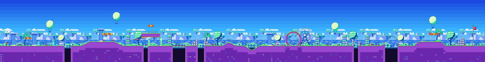

# super-mb

An original 32px platformer tileset that covers the classic 8-bit block-platformer vocabulary
(ground, bricks, bonus blocks, pipes, stairs, pits) and adds 16-bit style momentum terrain:
ramps, rolling hills, quarter pipes, kickers and full 360° loops. It ships with example levels,
a procedural level generator, and a small physics engine that proves the loops work.

All art is generated by code in this repo; nothing is copied from an existing game.

The look is a loud mid-90s 32-bit arcade style: saturated neon colour pairs, diamond-patterned
ground with bevelled panels, two-colour candy-striped floor and ceiling edges, chrome-like wall trim,
glossy blocks, skies drawn as discrete colour bands, and geometric backdrops (prisms, banded domes,
lollipop trees, lit skylines, stepped pyramids). The three themes are Garden, Neon and Sunset
(file names keep the original keys `meadow`, `cavern`, `dusk`).




## What is here

| Path | What |
| --- | --- |
| `assets/tileset-{meadow,cavern,dusk}.png` | The tile sheet in three themes (32 columns, 32px tiles, 585 tiles) |
| `assets/bg-{meadow,cavern,dusk}.png`, `assets/backgrounds.json` | Parallax background strips and their scroll table |
| `assets/props-{meadow,cavern,dusk}.png`, `assets/props.json` | Big background set pieces and their rectangles |
| `assets/shaders/*.frag` | The CRT television shader passes |
| `assets/tileset.tsj` | Tiled tileset (names, kinds, loop path and angles as tile properties) |
| `assets/tileset.json` | Engine metadata: per-tile pixel masks, surface angles, autotile table, prefab stamps |
| `levels/*.tmj` | Four hand-made levels and four generated ones, in Tiled JSON |
| `demo/index.html` | Self-contained playable demo: open it in a browser |
| `src/tileset/` | Tileset generator |
| `src/level/` | Level builder, example levels, generator, Tiled import/export |
| `src/engine/` | Physics sim and the playtest bot |

```
npm install
npm run build   # regenerates assets/, levels/, docs/, demo/
npm test
```

## Tileset

- **Ground**: a full 47-tile "blob" autotile set, so any ground shape gets correct edges and corners.
- **Blocks**: brick, bonus, used, hard (stairs), pipe (2x2, body repeats), bridge, jump-through planks, spikes.
- **Objects and sprites**: gem, spring, booster (left/right), checkpoint lamp (off/on), goal pole and
  banner, player ball, walker enemy, hovering flyer enemy.
- **Ceilings**: every downward-facing ground surface (cave roofs, the underside of floating decks and
  tunnels, the top of a loop's inside) gets its own crust in a per-theme colour, and stalactite /
  root tiles hang beneath flat undersides.
- **Bedrock**: three tiles below any surface the soil darkens into bedrock, with occasional stones, ore
  and fossils, so large ground areas are not one flat texture.
- **Decor**: bush, flowers, grass tuft, mushroom, crystal cluster, rock, arrow signpost, cloud,
  background hill. Levels pick flora to suit the theme.
- **Momentum pieces** (`src/tileset/prefabs.js`): 45° ramps (1-3 tiles), 22° ramps, hump, dip,
  S-curve rolls, quarter pipe up/down, S-drop/S-climb, kicker, and loops with 6 and 10 tile inner diameter.

Every ground tile and every curved piece is rendered by one function (`src/tileset/terrain.js`)
from a solid/air mask, which is why slopes and loops join flat ground without seams. The same
mask yields the collision data: a 32x32 pixel mask per tile and a surface angle for each of the
four sensor directions. To add a new curve, describe its height function or mask in `prefabs.js`.

Tile size is one constant (`TILE` in `src/core/units.js`). Art, curve geometry and physics are
written on a 16-unit design grid and scaled from it, so the sheet re-renders at a new resolution
with smooth curves rather than doubled pixels.

## Parallax backgrounds

Each theme has a stack of horizontally tileable strips (`src/tileset/background.js`): cloud bands
that drift on their own, a far range of prisms, towers or pyramids, a banded water strip, striped
domes and a foreground row of trees or prisms. Every strip
scrolls at its own fraction of the camera speed, and the water strip is line-scrolled: each row
moves slightly faster than the one above, which gives the receding-floor look of 16-bit backdrops.
`backgrounds.json` lists each strip's position in the sheet, its vertical offset from the horizon,
scroll factor(s) and drift, so another engine can reproduce the effect.

## Player

The player is a photo head riding upright inside a clear rolling sphere, a little under two tiles
across. `scripts/make-head.py photo.jpg` cuts a head out of a green-screen portrait into
`assets/hero-head.png` (384px, transparent) and `src/web/head.js`. The demo renders at three times
the art resolution, so the pixel art stays crisp while the photo is drawn smooth and sharp.

The sphere squashes and stretches: it stretches along the direction of travel in the air, squashes
into the ground on landing, kicks on jumps, boosts and bounces, and the head leans into the run and
lags a little when rising or falling. This is drawing only (`updateMorph` in `src/web/main.js`);
the collision shape stays a circle.

## Factory zone

The fourth theme (`factory`) is a chemical works: steel-plate ground with hazard-striped edges, a
magenta chemical channel, smog bands, chimneys, giant storage spheres, trusses and pipe runs in
the backdrop. It adds machines that do something:

- **Conveyor belts** (`b.belt(n, dir)`): animated tiles that carry you along, with or against you.
- **Acid vats** (`b.acid(n)`): animated liquid that kills on contact.
- **Steam vents** (`b.vent(dx, phase)`): a launcher that only fires part of each cycle.
- **Presses** (`b.crusher(dx, clearance, phase)`): slam down from a ceiling and stop just over a tile
  above the floor, so they only catch you if you jump.

and seven animated machinery props (eight frames each): meshing cogs, twin pistons, a boiler with a
bubbling sight glass, a smokestack, a flywheel engine, a sloshing storage tank and a pipe run with
a turning valve. In factory levels the generator adds conveyor, acid-vat, belt-into-vat, press-hall
and vent-lift pieces to its tables. Animated tiles are consecutive ids with a `frames` count on the
first; animated props list `frames` in `props.json`.

## Set pieces

`src/tileset/props.js` draws fourteen large scenery props (two to eight tiles across): ferris wheel,
striped arch, giant lollipop tree, palm, totem, signal pylon, crystal cluster, waterfall, cog,
orb on a pedestal, broken column, and three that float (balloon, blimp, hoop). They stand in the
level plane behind the terrain with no collision, painted in the backdrop colours so they read as
scenery. `LevelBuilder.decorate()` scatters one every five to ten tiles from the theme's set, and
levels carry them as `level.props` (`prop` objects in the Tiled export).

The parallax stack also has giant far landmarks: floating islands with waterfalls and a ringed
planet (Garden), colossal half-rings, spires and a moon (Neon), palm islets and an airship (Sunset).

## CRT shader

`src/shader/crt.js` is a four-pass CRT television filter in GLSL ES 1.00 (also written out as plain
files in `assets/shaders/`); `src/web/crt.js` is a small WebGL1 runner for it.

1. **Signal**: the frame is encoded as a composite signal (luma plus a chroma subcarrier whose phase
   flips each line and frame) and decoded again, which produces colour bleed, dot crawl, cross-colour
   fringes and edge ringing. RF faults are added to the signal first: snow, impulse sparkles, a
   herringbone beat pattern, a ghost echo, per-line jitter and weave, and a rolling hum bar.
2. **Phosphor**: per-channel afterglow, red decaying slowest.
3. **Blur**: half-size gaussian for halation.
4. **Tube**: barrel curvature, convergence error growing toward the edges, gaussian beam scanlines
   that fatten with brightness, interlaced field offset, RGB subpixel mask (aperture grille, slot
   mask or dot triads), halation, corner dimming, a colour purity blotch, field flicker, raised
   black level, glass glare and a degauss wobble.

The curvature is normalised so the picture's corners land exactly on the output corners: the bulge
is cropped as overscan at the edges and no border ever shows.

## Loops

A loop is a ring standing on the floor, so the way in is at ground level with open air around it.
Its lower-left quarter is solid only on path B and its
lower-right quarter only on path A. You arrive on path A, run through the left wall, up the right
side, and crossing the top switches you to path B, so the left side catches you and the right wall
lets you out. The rule is a few lines in `Sim._paths()`.

## Levels

Levels are written against `LevelBuilder`, a left-to-right cursor API:

```js
b.flat(8).blocks('B?B', 4, 2).flat(6).pipe(2).flat(4)
 .gap(3).flat(4).runUp(6).piece('loop6').gemsInLoop().flat(6).goal();
```

`src/level/examples.js` has the three hand-made levels. `levelToTiled` / `levelFromTiled`
convert to and from Tiled maps (layers `decor`, `terrain`, `objects`).

## Generator

`generateLevel(ts, { seed, length, difficulty, flow, vertical, theme })` in `src/level/generator.js`
builds levels 128 tiles tall and several hundred wide.

1. **Shape**: the main route runs across plateaus joined by connectors that change height by 10-25
   tiles: ascents (spring towers, quarter-pipe wall launches, terraces) and descents (cliff plunges,
   ledge cascades, S-drop slaloms), often with a tall loop (14 or 18 tiles across) after them.
2. **Tiers**: the main route leaves ten-tile "pads". From a pad the generator can hang a tier above
   the route, placed just over whatever is built below it, and tiers leave pads of their own, so up
   to three stack. A tier starts with a hanging wall and a spring beside it: the spring sends you
   straight up, the wall stops you drifting under the deck. Falling off a tier, or through one of its
   pits, drops you to the route below.
3. **Basements**: under some plateaus there is an enclosed lower route. You enter by a drop shaft, or
   by any pit of the route above (which stops being lethal), and leave by a spring well at the far end.
4. **Pieces**: each route is filled with weighted pieces that leave the cursor on flat ground, so any
   piece can follow any other: single obstacles, layered pieces (upper decks, tunnels, plank bridges,
   spike trenches, block towers) and combos (double loops, half-pipes, wave runs, loop into kicker).
5. **Rules from physics**: pits, ledges and pipes stay within one jump (`RULES`); anything that needs
   speed gets boosters and a run-up; launches get a landing runway. Ground is laid as slabs of finite
   thickness, and falling is fatal a few tiles below the lowest ground nearby.
6. **Playtest**: a look-ahead bot (`src/engine/bot.js`) plays the result twice with the real
   simulation, once taking every lift and once staying off the upper tiers. If either run fails, the
   generator retries with a derived seed. `level.meta.validated` records the outcome.

`vertical` (0-1) sets how many tiers, basements and connectors appear; 0 gives a single flat route.
The same seed and options always produce the same level. The three hand-made levels are the older
single-route, 30-tile-tall kind.
