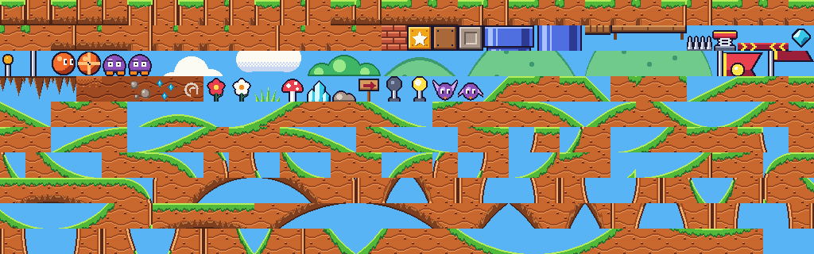

# super-mb

An original 32px platformer tileset that covers the classic 8-bit block-platformer vocabulary
(ground, bricks, bonus blocks, pipes, stairs, pits) and adds 16-bit style momentum terrain:
ramps, rolling hills, quarter pipes, kickers and full 360° loops. It ships with example levels,
a procedural level generator, and a small physics engine that proves the loops work.

All art is generated by code in this repo; nothing is copied from an existing game.




## What is here

| Path | What |
| --- | --- |
| `assets/tileset-{meadow,cavern,dusk}.png` | The tile sheet in three themes (32 columns, 32px tiles, 318 tiles) |
| `assets/bg-{meadow,cavern,dusk}.png`, `assets/backgrounds.json` | Parallax background strips and their scroll table |
| `assets/tileset.tsj` | Tiled tileset (names, kinds, loop path and angles as tile properties) |
| `assets/tileset.json` | Engine metadata: per-tile pixel masks, surface angles, autotile table, prefab stamps |
| `levels/*.tmj` | Three hand-made levels and three generated ones, in Tiled JSON |
| `demo/index.html` | Self-contained playable demo: open it in a browser |
| `src/tileset/` | Tileset generator |
| `src/level/` | Level builder, example levels, generator, Tiled import/export |
| `src/engine/` | Physics sim and the playtest bot |

```
npm install
npm run build   # regenerates assets/, levels/, docs/, demo/
npm test
```

## Tileset

- **Ground**: a full 47-tile "blob" autotile set, so any ground shape gets correct edges and corners.
- **Blocks**: brick, bonus, used, hard (stairs), pipe (2x2, body repeats), bridge, jump-through planks, spikes.
- **Objects and sprites**: gem, spring, booster (left/right), checkpoint lamp (off/on), goal pole and
  banner, player ball, walker enemy, hovering flyer enemy.
- **Ceilings**: every downward-facing ground surface (cave roofs, the underside of floating decks and
  tunnels, the top of a loop's inside) gets its own crust in a per-theme colour, and stalactite /
  root tiles hang beneath flat undersides.
- **Bedrock**: three tiles below any surface the soil darkens into bedrock, with occasional stones, ore
  and fossils, so large ground areas are not one flat texture.
- **Decor**: bush, flowers, grass tuft, mushroom, crystal cluster, rock, arrow signpost, cloud,
  background hill. Levels pick flora to suit the theme.
- **Momentum pieces** (`src/tileset/prefabs.js`): 45° ramps (1-3 tiles), 22° ramps, hump, dip,
  S-curve rolls, quarter pipe up/down, S-drop/S-climb, kicker, and loops with 6 and 10 tile inner diameter.

Every ground tile and every curved piece is rendered by one function (`src/tileset/terrain.js`)
from a solid/air mask, which is why slopes and loops join flat ground without seams. The same
mask yields the collision data: a 32x32 pixel mask per tile and a surface angle for each of the
four sensor directions. To add a new curve, describe its height function or mask in `prefabs.js`.

Tile size is one constant (`TILE` in `src/core/units.js`). Art, curve geometry and physics are
written on a 16-unit design grid and scaled from it, so the sheet re-renders at a new resolution
with smooth curves rather than doubled pixels.

## Parallax backgrounds

Each theme has a stack of horizontally tileable strips (`src/tileset/background.js`): cloud bands
that drift on their own, a far range, a water strip, near hills and a foreground ridge. Every strip
scrolls at its own fraction of the camera speed, and the water strip is line-scrolled: each row
moves slightly faster than the one above, which gives the receding-floor look of 16-bit backdrops.
`backgrounds.json` lists each strip's position in the sheet, its vertical offset from the horizon,
scroll factor(s) and drift, so another engine can reproduce the effect.

## Loops

A loop is a block with a circular hole. Its lower-left quarter is solid only on path B and its
lower-right quarter only on path A. You arrive on path A, run through the left wall, up the right
side, and crossing the top switches you to path B, so the left side catches you and the right wall
lets you out. The rule is a few lines in `Sim._paths()`.

## Levels

Levels are written against `LevelBuilder`, a left-to-right cursor API:

```js
b.flat(8).blocks('B?B', 4, 2).flat(6).pipe(2).flat(4)
 .gap(3).flat(4).runUp(6).piece('loop6').gemsInLoop().flat(6).goal();
```

`src/level/examples.js` has the three hand-made levels. `levelToTiled` / `levelFromTiled`
convert to and from Tiled maps (layers `decor`, `terrain`, `objects`).

## Generator

`generateLevel(ts, { seed, length, difficulty, flow, theme })` in `src/level/generator.js`:

1. **Pacing**: the level is a chain of zones, each a block zone or a flow zone. `flow` sets the mix,
   difficulty ramps with progress, every third zone is a breather.
2. **Pieces**: each zone is filled with weighted pieces that leave the cursor on flat ground, so any
   piece can follow any other. They range from single obstacles to layered pieces (upper decks,
   tunnels, plank bridges, spike trenches, block towers) and combos (double loops, half-pipes,
   wave runs, a loop straight into a kicker). The picker steers ground height back toward the baseline.
3. **Rules from physics**: pits, ledges and pipes stay within one jump (`RULES`); anything that needs
   speed gets boosters and a run-up; launches get a landing runway.
4. **Playtest**: a look-ahead bot (`src/engine/bot.js`) plays the result using the real simulation.
   If it cannot reach the goal the generator retries with a derived seed. `level.meta.validated`
   records the outcome.

The same seed and options always produce the same level.
